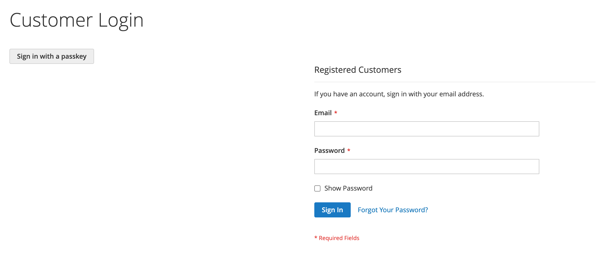

# DmLab_CustomerPasskey

> Passwordless storefront login for Magento 2 with passkeys (WebAuthn / FIDO2).

[](https://github.com/dmlab-work/module-customer-passkey/actions/workflows/ci.yml) [](https://codecov.io/gh/dmlab-work/module-customer-passkey) [](https://packagist.org/packages/dmlab/module-customer-passkey) [](https://packagist.org/packages/dmlab/module-customer-passkey) [](https://packagist.org/packages/dmlab/module-customer-passkey) [](LICENSE) 

Customers sign in to your store with Touch ID, Face ID, Windows Hello or a security key instead of a password.
There is no password to steal or phish, and nothing to remember or reset.
Free and self-contained: Magento checks the passkey itself, no external service or account needed.



## Install

```bash
composer require dmlab/module-customer-passkey
bin/magento module:enable DmLab_CustomerPasskey
bin/magento setup:upgrade
bin/magento setup:di:compile        # production mode
```

`setup:upgrade` creates the `dmlab_passkey_credential` table (one row per passkey, removed with its customer).
Then switch it on in Stores → Configuration → **DMLab → Customer Passkey** (*Enable Passkey Login*).

## Requirements

- Magento 2.4.7+ · PHP 8.2–8.5
- `ext-sodium`
- HTTPS on the storefront (browsers offer passkeys only on secure pages)

## Hyvä

A Hyvä (Alpine.js) login-button template ships with the module, but the theme layout must be edited by hand. In the Hyvä theme's `Magento_Customer/layout/customer_account_login.xml`:

```xml
<referenceBlock name="dmlab.customer.passkey.button" template="DmLab_CustomerPasskey::login/passkey-button-hyva.phtml"/>
```

My Account → Passkeys (adding, renaming and deleting passkeys) is Luma/RequireJS only; there is no Hyvä variant yet.

Pairs with [Customer SSO](https://github.com/dmlab-work/module-customer-sso) (sign-in through your identity provider): each adds its own button to the login page, both resolve to the same customer account, neither depends on the other.

## Configuration

Admin → Stores → Configuration → **DMLab → Customer Passkey**
(`dmlab_customer_passkey/*`). Configurable per website/store view.

**General** (`general/*`)

| Field | Default | Notes |
|---|---|---|
| Enable Passkey Login | No | Master switch; adds the button and enables all endpoints. |
| Relying Party Display Name | store name | Name the authenticator shows during a ceremony. |
| Relying Party ID | store host | Domain passkeys are bound to: the store host or a parent domain of it (other values are ignored). A parent domain shares passkeys across subdomain stores. Changing it invalidates existing passkeys. |
| User Verification | required | `required` / `preferred` / `discouraged`. Only `required` is enforced server-side; lower values let a passkey sign in on device possession alone (no PIN/biometric). |
| Authenticator Attachment | any | `any` / `platform` (Touch ID, Windows Hello) / `cross-platform` (security keys). |
| Ceremony Timeout (ms) | 60000 | Browser wait for the authenticator. |
| Allow Passwordless Sign-In | Yes | Offers usernameless "Sign in with a passkey" via discoverable credentials. With No there is no storefront passkey sign-in (no button; `login/options` requires an email). |
| Re-authentication Window (s) | 300 | Adding a passkey within this time after sign-in needs no password; later the current password is asked. |

**Notifications** (`notification/*`)

| Field | Default | Notes |
|---|---|---|
| Email Customer on Passkey Changes | Yes | Emails the customer when a passkey is added or removed (by the customer or an admin). |
| Email Sender | General Contact | Store email identity. |
| Passkey Added / Removed Template | module default | Override under Marketing → Email Templates. |

The **RP ID** defaults to the base-URL host (e.g. `magento.loc`). The ceremony origin must
exactly match one of the current store view's base URLs (secure/unsecure, scheme + host + port);
other subdomains are refused. Both must be stable HTTPS hosts.

## Usage

**Add a passkey** — a signed-in customer opens My Account → **Passkeys**, clicks *Add a passkey* and confirms
the browser prompt. The same page renames and deletes passkeys; a customer manages only their own. Outside the
re-authentication window adding or deleting asks for the current password first (wrong passwords count toward
Magento's customer lockout; a locked account is refused). Customers without a password (e.g. created via SSO)
are asked to sign in again; "Login as Customer" sessions always need the password.

**Sign in** — the *Sign in with a passkey* button on the login page needs no email: the browser offers the
customer's passkeys for this store, and a valid one signs them in and refreshes the minicart and customer name.
The button shows only when *Allow Passwordless Sign-In* is Yes.

**Admin revoke** — Customers → All Customers → edit → **Passkeys** tab lists the customer's passkeys
(label, created, last used, AAGUID) with a *Revoke* action for a lost device. Requires ACL
`DmLab_CustomerPasskey::manage` (Customers → All Customers → Manage Customer Passkeys).

## Browser / authenticator support

Any WebAuthn-capable browser: Chrome, Safari, Firefox, Edge. Authenticators: platform (Touch ID,
Face ID, Windows Hello, Android) and cross-platform (FIDO2 security keys). Passwordless requires
discoverable-credential support (current browsers + platform authenticators).

## Tests

```bash
vendor/bin/phpunit -c Test/Unit/phpunit.xml
```

Real-authenticator flows (Touch ID / security key) are verified manually.

## Architecture

Standalone: Magento is the WebAuthn relying party (`web-auth/webauthn-lib`); no `dmlab/*` dependency.

### Endpoints

Frontend router `customerpasskey`:

| Ceremony | Options | Verify |
|---|---|---|
| Registration (logged-in) | `customerpasskey/register/options` | `customerpasskey/register/verify` |
| Authentication | `customerpasskey/login/options` | `customerpasskey/login/verify` |
| Manage | `customerpasskey/manage/index`, `.../rename`, `.../delete` | |

Outside the re-authentication window `register/options` and `manage/delete` return
`401 {"success": false, "reauth": true, "message": "..."}`; retry with a `password` param.

Admin router `customerpasskey` (ACL `DmLab_CustomerPasskey::manage`): `customerpasskey/customer/revoke`
— POST `customer_id`, `entity_id`, `form_key`; redirects back to the customer edit page.

Every new passkey is a discoverable (resident) key. Login is discoverable-only: `allowCredentials` is always
empty, so the response is identical for any email. An optional `email` parameter on `login/options` only scopes
the challenge server-side — the assertion must then belong to that customer, and a rejected assertion counts
toward that account's native lockout.

Challenges are one-time, bound to their ceremony (a login challenge cannot complete a registration),
stored in the customer session and expire after the ceremony timeout + 60 s; ceremony endpoints are
rate-limited per client IP (Magento `RemoteAddress`).
WebAuthn user handles are opaque (HMAC of the customer id under the deployment key); passkeys
enrolled earlier keep their customer-id handle. Algorithms: ES256, EdDSA, RS256; attestation
`none` (packed self-attestation accepted).
The authenticator sign counter is persisted and checked on every assertion — a regression is
flagged as a possible clone and denied.

## License

[OSL-3.0](LICENSE) © DMLab. Commercial licensing and support: <https://dmlab.work>.
